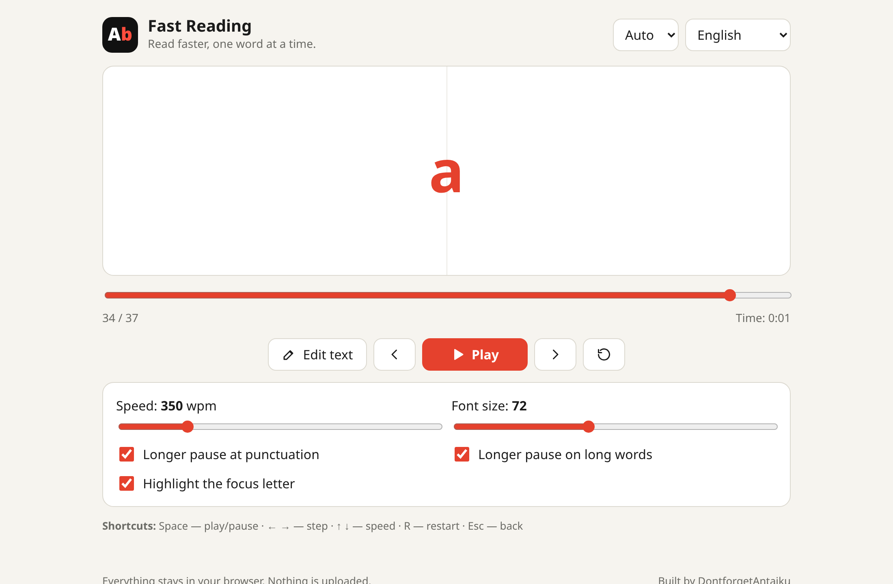
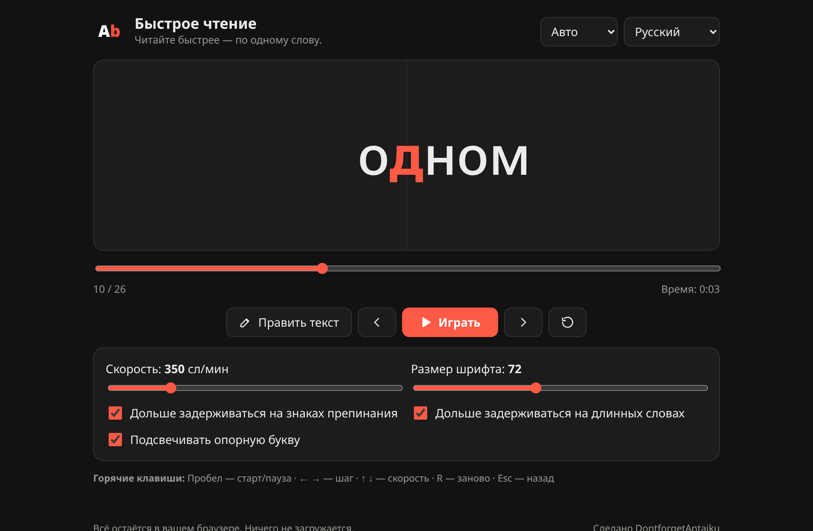
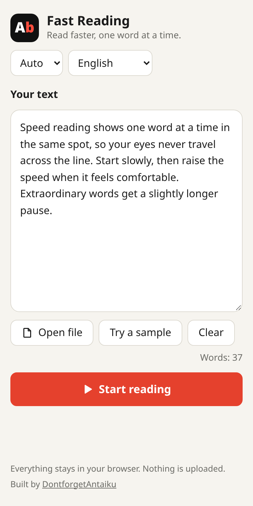

<div align="center">

# Fast Reading

**Read faster, one word at a time.**

Paste a text or open a file, pick a speed, and watch the words appear in one fixed spot —
your eyes stop travelling along the line, so you can read much faster.

Free · No account · No tracking · Works offline · Installable (PWA) · 12 languages



</div>

---

## Why it works

This is the *RSVP* technique (Rapid Serial Visual Presentation). Most of the time you spend reading
goes into eye movements along the line. Fast Reading removes them: every word is shown in the same
place, with its **focus letter** (the optimal recognition point) highlighted and locked to a
centre guide line, so your gaze never has to move.

Start at a comfortable speed (200–300 wpm) and raise it a little every few minutes.

## Features

- **Text or file** — type, paste, or open `.txt`, `.md`, `.html`, `.csv`, `.srt`, `.vtt`, `.fb2`, `.xml`, `.json`, `.log` …
  UTF-8 is tried first, then `windows-1251` (so old Cyrillic `.txt` files just work). Up to 5 MB.
- **Configurable speed** — 60 to 1500 words per minute, changeable while reading.
- **Smart timing** — optional longer pause on punctuation (`.` `!` `?` `,` `;` `:`) and on long words.
- **Focus letter** — highlighted in colour and aligned on the centre line (can be turned off).
- **Full control** — play / pause, step back and forward, restart, drag the progress bar to jump anywhere; remaining time is shown.
- **Font size** — 24–140 px; very long words shrink automatically to fit the screen.
- **CJK-aware** — Chinese, Japanese and Korean text without spaces is split into words with `Intl.Segmenter`.
- **12 languages** — the interface follows your browser language and can be switched at any time.
- **Light, dark or auto theme.**
- **Private by design** — everything runs in your browser; your text never leaves the device.
  Text and settings are remembered locally (`localStorage`); the **Clear** button wipes the text.
- **Works offline** — after the first visit a service worker keeps the whole app on the device; the footer shows "Ready to use offline" once it is ready. It can also be installed to the home screen / desktop as a PWA.
- **Mobile friendly** — responsive layout, large touch targets, safe-area aware.

<div align="center">

&nbsp;

</div>

## Keyboard shortcuts

| Key | Action |
|---|---|
| `Space` | Play / pause (restarts when the text has finished) |
| `←` / `→` | Previous / next word (pauses) |
| `↑` / `↓` | Speed +25 / −25 wpm |
| `R` | Restart |
| `Esc` | Back to the text |

## Languages

English · Русский · Українська · Deutsch · Español · Français · Italiano · Português · Polski · Čeština · Türkçe · Nederlands

The interface language is detected from the browser (`localStorage` → `navigator`) with English as
the fallback. The text you read can be in **any** language — the language setting only affects the UI.

### Adding a language

1. Copy [`frontend/src/i18n/locales/en.json`](frontend/src/i18n/locales/en.json) to `xx.json` and translate every value
   (keep the keys; `sampleText` is the demo text, `shortcutsText` the shortcut hint).
2. In [`frontend/src/i18n/index.ts`](frontend/src/i18n/index.ts) import the file and add it to the `resources` object and to `LANGUAGES`
   (the name is shown in the picker in its own language).

Right-to-left UI languages (Arabic, Hebrew) are not supported yet: the reader's focus-letter layout is left-to-right.

## Getting started

Requirements: Node.js 24 (current LTS) and npm.

```bash
cd frontend
npm ci
npm run dev        # http://localhost:5173
```

```bash
npm run build      # type-check + production build into frontend/dist
npm run preview    # serve the production build locally
```

> The service worker is registered in production builds only, so `npm run dev` never caches anything.

### Build with Docker

The repository ships a `frontend-builder` service that builds the site and copies the static files to a folder on the host.

```bash
cp .env.example .env
docker compose run --rm frontend-builder   # static files appear in ./deploy
```

| Variable | Default | Meaning |
|---|---|---|
| `FRONTEND_DEBUG` | `True` | Passed to the build; set `False` for production |
| `FRONTEND_BUILD_OUTPUT` | `./deploy` | Host folder that receives the built site |
| `HOST_UID` / `HOST_GID` | `1000` | Owner of the generated files |

## Deployment

The output is a plain static site: serve the folder with any web server over **HTTPS**
(required for the service worker and installation). Requirements for a correct setup:

- Fall back to `/index.html` for unknown paths.
- Serve `manifest.webmanifest` as `application/manifest+json`.
- Send `Cache-Control: no-cache` for `/sw.js` and `/index.html`; hashed files in `/assets/` can be cached forever (`immutable`).
- The app makes no network requests at runtime, so a strict CSP such as `default-src 'self'; script-src 'self' 'unsafe-inline'; style-src 'self' 'unsafe-inline'; img-src 'self' data:`
  works (the small inline script in `index.html` applies the saved theme before first paint).

### How the PWA updates

`sw.js` precaches the app shell and the hashed assets of the build, serves pages network-first (offline fallback to the cached app)
and static files cache-first. A new version activates immediately (`skipWaiting` + `clientsClaim`) and old caches are deleted;
the page checks for a new worker when it becomes visible, when the connection returns, and every 30 minutes.

## Project structure

```
frontend/
├── public/                 manifest.webmanifest, sw.js, favicon, icons/
├── src/
│   ├── components/         Header, InputPanel, Reader, Footer, Icons (each: Name/Name.tsx + Name.css)
│   ├── hooks/useSettings.ts  persisted settings + theme
│   ├── i18n/               i18next setup and locales/*.json
│   ├── lib/text.ts         tokenizer, focus-letter, timing, file decoding
│   ├── pwa.ts              service-worker registration
│   └── App.tsx
├── vite.config.ts          also fills the precache list of sw.js after the build
└── Dockerfile
docker-compose.yml          frontend-builder service
docs/                       screenshots used in this README
```

**Stack:** Vite · React 19 · TypeScript · react-i18next + i18next-browser-languagedetector · plain CSS (no UI framework, system fonts).

## How the timing works

```
delay = 60000 / wpm
      × 2.2   if the word ends a sentence  (. ! ? …)
      × 1.6   if it ends a clause          (, ; : — –)
      + 0.12 per letter beyond 8 (max +1)  for long words
```

The multipliers are optional and can be switched off in the settings. The focus letter is the 2nd letter of words up to 5 characters, then moves right
(3rd for 6–9, 4th for 10–13, 5th beyond), skipping leading punctuation such as quotes.

## Privacy

No analytics, no cookies, no third-party requests, no fonts or scripts from a CDN.
Files you open are read locally with the browser's `File` API and are never uploaded.

## Contributing

Issues and pull requests are welcome — especially for new or corrected translations.
Please run `npm run build` (it type-checks) before opening a PR.

## Credits

Built by [DontforgetAntaiku](https://dontforgetantaiku.dev/).
